# Previsão de Rotatividade de Funcionários — Salifort Motors


Estudo de **People Analytics e Data Scence** desenvolvido como projeto final (*Capstone*) da certificação **Google Advanced Data Analytics**. O trabalho investiga os fatores organizacionais associados ao desligamento de colaboradores na **Salifort Motors** e constrói modelos estatísticos e de aprendizado de máquina (*Regressão Logística, Árvore de Decisão, Random Forest e XGBoost*) estruturados pelas quatro etapas da metodologia **PACE** (*Plan, Analyze, Construct, Execute*).

> **Destaques dos Resultados:**
> - **Base analisada:** `14.999` registros brutos → **`11.991` colaboradores únicos** após limpeza (`16,60%` de desligamentos).
> - **Descoberta central de negócio:** a rotatividade concentra-se em **três perfis distintos** — profissionais em **sobrecarga extrema** (`6–7` projetos, `240–310 h/mês`, satisfação `~0,10`), profissionais em **subalocação** (`2` projetos, `130–160 h/mês`, `54,2%` de saída) e talentos com **`4–5` anos de casa** sem progressão salarial ou promoção recente.
> - **Melhor modelo (Cenário A — com todas as variáveis):** **XGBoost** alcançou **ROC-AUC de `0,9895`**, **F1-score de `0,9547`**, **Recall de `0,9406`** e **Acurácia de `0,9850`**, empatando em acurácia com a **Random Forest** (maior **Precision: `0,9864`**).
> - **Alta resiliência (Cenário B — sem `satisfaction_level`):** o **XGBoost B** sustentou **ROC-AUC de `0,9835`** e **Recall de `0,9257`**, provando que o RH consegue identificar equipes vulneráveis apenas com indicadores operacionais de jornada, projetos, avaliação e tempo de empresa.

---

## Sumário

1. [Contexto de Negócio e Dicionário de Dados](#1-contexto-de-negócio-e-dicionário-de-dados)
2. [Visão Geral da Metodologia PACE](#2-visão-geral-da-metodologia-pace)
3. [Etapa 1 — Plan (Planejar)](#3-etapa-1--plan-planejar)
4. [Etapa 2 — Analyze (Analisar)](#4-etapa-2--analyze-analisar)
   - [4.1 Limpeza, Duplicatas e Outliers](#41-saneamento-duplicatas-e-outliers)
   - [4.2 Análise Exploratória Visual (EDA) e Perfis de Saída](#42-análise-exploratória-visual-eda-e-perfis-de-saída)
   - [4.3 Testes Formais de Hipóteses Estatísticas](#43-testes-formais-de-hipóteses-estatísticas)
5. [Etapa 3 — Construct (Construir)](#5-etapa-3--construct-construir)
   - [5.1 Preparação de Atributos e Multicolinearidade (VIF)](#51-preparação-de-atributos-e-multicolinearidade-vif)
   - [5.2 Desenho Experimental: Cenários A, B e C](#52-desenho-experimental-cenários-a-b-e-c)
   - [5.3 Desempenho Comparativo dos 10 Modelos](#53-desempenho-comparativo-dos-10-modelos)
6. [Etapa 4 — Execute (Executar)](#6-etapa-4--execute-executar)
   - [6.1 Importância das Variáveis (Feature Importance)](#61-importância-das-variáveis-feature-importance)
   - [6.2 Calibração de Limiar de Decisão (Threshold Tuning)](#62-calibração-de-limiar-de-decisão-threshold-tuning)
   - [6.3 Recomendações Estratégicas para Liderança e RH](#63-recomendações-estratégicas-para-liderança-e-rh)
   - [6.4 Limitações, Ética e Próximos Passos](#64-limitações-ética-e-próximos-passos)
7. [Estrutura do Repositório e Como Executar](#7-estrutura-do-repositório-e-como-executar)

---

## 1. Contexto de Negócio e Dicionário de Dados

A **Salifort Motors** enfrenta uma taxa expressiva de rotatividade (*turnover*), gerando custos financeiros elevados com recrutamento, seleção, ambientação e treinamento, além de perda de capital intelectual e sobrecarga nas equipes remanescentes. A liderança executiva solicitou ao time de análise de dados um estudo capaz de:

1. **Diagnosticar os fatores** que diferenciam colaboradores que permanecem daqueles que deixam a empresa.
2. **Construir e validar modelos preditivos** para estimar a probabilidade de saída (`left = 1`).
3. **Propor intervenções práticas e éticas** para fortalecer a retenção e a satisfação no trabalho.

### Dicionário de Dados (`Data/HR_capstone_dataset.csv`)

O conjunto bruto reúne **14.999 registros** e **10 colunas**, padronizadas em `snake_case` durante o pré-processamento:

| Coluna Original | Coluna Padronizada | Tipo | Escala / Domínio | Descrição de Negócio |
| :--- | :--- | :---: | :--- | :--- |
| `satisfaction_level` | `satisfaction_level` | `float` | `0,09` a `1,00` | Índice de satisfação autorreportado pelo colaborador na pesquisa de RH. |
| `last_evaluation` | `last_evaluation` | `float` | `0,36` a `1,00` | Nota obtida na última avaliação formal de desempenho. |
| `number_project` | `number_projects` | `int` | `2` a `7` projetos | Quantidade de projetos nos quais o funcionário está/esteve alocado. |
| `average_montly_hours` | `average_monthly_hours` | `int` | `96` a `310` h/mês | Média mensal de horas trabalhadas pelo colaborador. |
| `time_spend_company` | `tenure` | `int` | `2` a `10` anos | Tempo de permanência (anos de casa) na Salifort Motors. |
| `Work_accident` | `work_accident` | `int` | `0` (Não), `1` (Sim) | Indica se o colaborador sofreu acidente de trabalho registrado. |
| `promotion_last_5years` | `promotion_last_5_years` | `int` | `0` (Não), `1` (Sim) | Indica se houve promoção formal nos últimos 5 anos. |
| `Department` | `department` | `string` | 10 departamentos | Área funcional (`sales`, `technical`, `support`, `IT`, `RandD`, `hr`, etc.). |
| `salary` | `salary` | `string` | `low`, `medium`, `high` | Faixa salarial relativa do cargo/colaborador. |
| **`left`** *(Alvo)* | **`left`** | `int` | `0` (Ficou), `1` (Saiu) | **Variável-alvo:** status de desligamento (inclui saídas voluntárias e demissões). |

---

## 2. Visão Geral da Metodologia PACE

<p align="center">
  
</p>

Todo o ciclo analítico foi organizado segundo o framework **PACE**, conectando o entendimento de negócio à validação estatística, experimentação em múltiplos cenários de Machine Learning e tradução executiva:

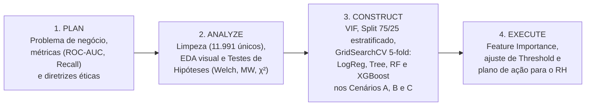

---

## 3. Etapa 1 — Plan (Planejar)


Na etapa inicial de planejamento, foram estabelecidos o escopo analítico, os critérios de avaliação e as salvaguardas metodológicas antes da modelagem:

<br clear="left"/>

- **Partes interessadas (*Stakeholders*):** Liderança Sênior e Diretoria de Recursos Humanos (RH), interessadas em reduzir custos de reposição de pessoal e melhorar o clima organizacional.
- **Estratégia de métricas para classes desbalanceadas:** como `83,4%` dos colaboradores permanecem ativos e `16,6%` saíram, um classificador trivial que previsse "ninguém sai" já teria `83,4%` de acurácia com `0%` de utilidade prática. Por isso, priorizamos:
  - **ROC-AUC:** métrica principal de seleção no `GridSearchCV`, medindo a capacidade global de separação entre ativos e desligados em todos os pontos de corte.
  - **Recall (Sensibilidade da classe `left = 1`):** proporção de saídas reais corretamente identificadas, essencial para não deixar grupos em risco passarem despercebidos.
  - **Precision:** proporção de alertas positivos que correspondem a desligamentos reais, evita sobrecarga operacional do RH com falsos alarmes.
  - **F1-score:** média harmônica entre *Precision* e *Recall*.
- **Riscos mapeados desde a concepção:**
  1. **Possível vazamento temporal (*Data Leakage*) em `satisfaction_level`:** o dataset não informa a data de aplicação da pesquisa; caso a nota reflita o sentimento de quem já havia decidido sair, o modelo pode depender excessivamente dessa variável. Isso motivou a criação do **Cenário B (sem `satisfaction_level`)**.
  2. **Composição mista do alvo `left`:** engloba tanto pedidos de demissão quanto desligamentos involuntários, exigindo cautela na interpretação causal.

---

## 4. Etapa 2 — Analyze (Analisar)


A etapa **Analyze** consolidou a limpeza dos dados, o diagnóstico exploratório dos padrões não lineares de rotatividade e os testes estatísticos de significância.

<br clear="left"/>

### 4.1 Limpeza, Duplicatas e Outliers

1. **Valores ausentes:** `0` registros nulos em todas as 10 colunas.
2. **Remoção de duplicatas exatas:** foram identificadas e removidas **`3.008` linhas duplicadas** (`20,05%` do arquivo bruto), resultando na base analítica limpa `df_clean` com **`11.991` registros únicos**:
   - Permaneceram (`left = 0`): **`10.000`** colaboradores (`83,40%`).
   - Saíram (`left = 1`): **`1.991`** colaboradores (`16,60%`).
3. **Inspeção de *outliers* em `tenure` (tempo de empresa):** pelo critério do intervalo interquartil (`Q1 = 3`, `Q3 = 4`, `IQR = 1`, limite superior `Q3 + 1,5 × IQR = 5,5 anos`), **`824` registros** com `6` a `10` anos de casa figuram como *outliers* estatísticos (`13,2%` de saída nesse grupo). Na etapa de modelagem comparativa (`df_model = 11.167` linhas), esses registros foram filtrados para atender à sensibilidade da Regressão Logística, preservando a mesma base de treino/teste entre os algoritmos.

<p align="center">
  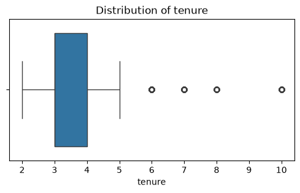
</p>

---

### 4.2 Análise Exploratória (EDA) e Perfis de Saída

#### A. Satisfação, Jornada Mensal e os 3 Clusters de Desligamento

O painel abaixo revela a estrutura central do problema de rotatividade na Salifort Motors:

<p align="center">
  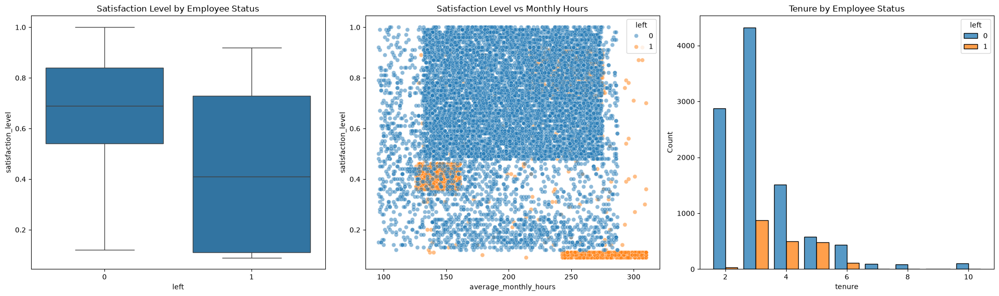
</p>

A inspeção conjunta do boxplot de satisfação e do gráfico de dispersão (`satisfaction_level` × `average_monthly_hours`) evidencia **três perfis nítidos** entre os colaboradores que deixaram a empresa (pontos laranjas):

1. **Perfil 1 — Exaustão / *Burnout* (`240–310 h/mês` e satisfação `~0,09–0,11`):** colaboradores com jornadas extremas (muito acima das ~160–175 h regulares) e satisfação colapsada.
2. **Perfil 2 — Subalocação / Desengajamento (`130–160 h/mês` e satisfação `0,36–0,46`):** colaboradores com carga horária reduzida e alocados em apenas `2` projetos, sinalizando subaproveitamento ou desligamento precoce.
3. **Perfil 3 — Alta Performance com `4–5` Anos de Casa (`220–275 h/mês` e satisfação elevada `0,72–0,92`):** profissionais bem avaliados e satisfeitos com o trabalho em si, mas concentrados nas faixas de `4` e `5` anos de empresa, perfil clássico de perda de talentos para o mercado por estagnação salarial ou falta de promoção.

---

#### B. Padrão em "U" no Número de Projetos e Curva por Tempo de Empresa

A relação entre volume de projetos e desligamento é fortemente **não linear**, formando uma curva em **"U"**:

<table>
  <tr>
    <td width="52%" align="center">
      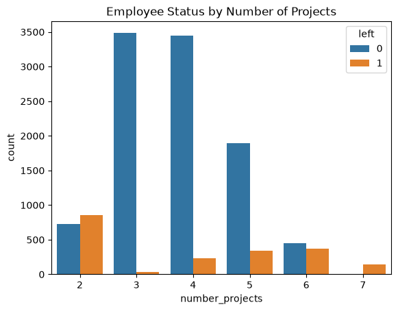
    </td>
    <td width="48%" valign="top">

| Nº de Projetos | Total | Ativos (`0`) | Saídas (`1`) | Taxa de Saída |
| :---: | :---: | :---: | :---: | :---: |
| **`2`** | 1.582 | 725 | 857 | **54,17%** |
| **`3`** | 3.520 | 3.482 | 38 | **1,08%** |
| **`4`** | 3.685 | 3.448 | 237 | **6,43%** |
| **`5`** | 2.233 | 1.890 | 343 | **15,36%** |
| **`6`** | 826 | 455 | 371 | **44,92%** |
| **`7`** | 145 | 0 | 145 | **100,00%** |

</td>
  </tr>
</table>

- **Faixa saudável (`3` a `4` projetos):** concentra `60%` do quadro da empresa com taxas mínimas de saída (`1,08%` e `6,43%`).
- **Extremos críticos:** mais da metade (`54,17%`) de quem tem apenas `2` projetos sai, enquanto em `6` projetos a saída salta para `44,92%` e em **`7` projetos atinge `100%`** (todos os `145` colaboradores deixaram a Salifort Motors).
- **Evolução por `tenure` (tempo de casa):** a taxa de saída sobe de **`1,07%`** no 2º ano para **`16,84%`** no 3º ano, **`24,69%`** no 4º ano e atinge o pico de **`45,39%` no 5º ano**, recuando para `20,11%` no 6º ano e **`0,00%`** entre veteranos de `7` a `10` anos (`282` colaboradores ativos).

---

#### C. Faixa Salarial, Promoções e Departamentos

<table>
  <tr>
    <td width="50%" align="center">
      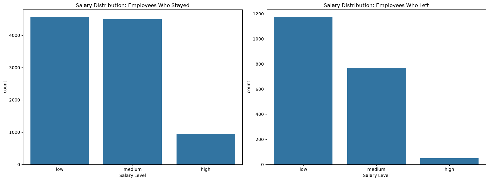
    </td>
    <td width="50%" align="center">
      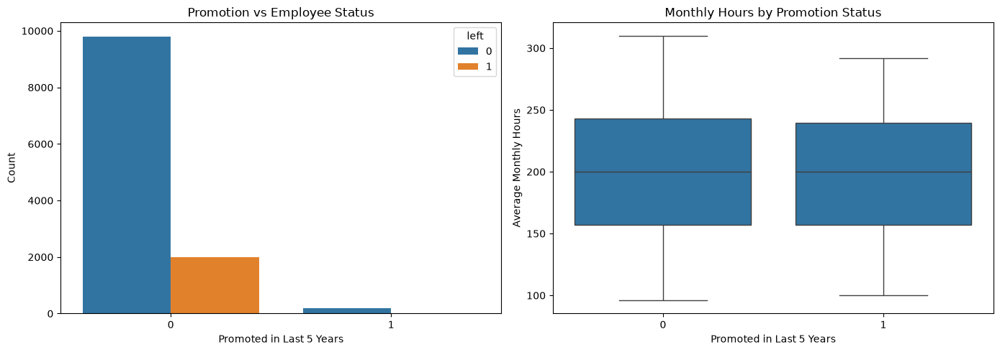
    </td>
  </tr>
</table>

<p align="center">
  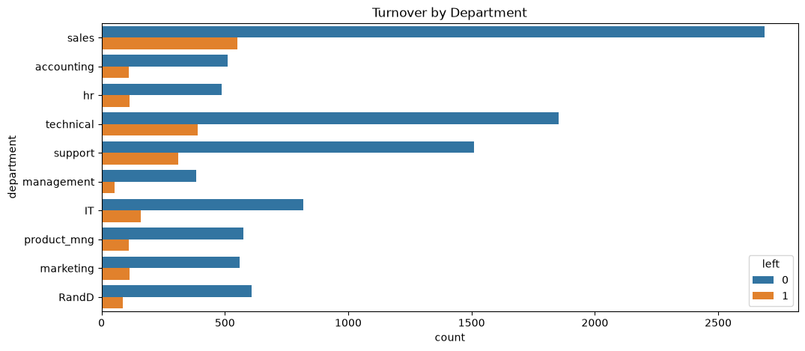
</p>

- **Faixa salarial (`salary`):** a rotatividade cai de forma consistente conforme a remuneração sobe, **`20,45%`** em `low` (`1.174 / 5.740`), **`14,62%`** em `medium` (`769 / 5.261`) e apenas **`4,85%`** em `high` (`48 / 990`).
- **Promoções (`promotion_last_5_years`):** apenas `203` funcionários (`1,69%` da base limpa) foram promovidos nos últimos 5 anos. Entre os promovidos, a saída foi de **`3,94%`**, contra **`16,82%`** entre os não promovidos, embora ambos trabalhem uma mediana idêntica de `~200 h/mês`.
- **Departamentos (`department`):** a dispersão entre áreas é moderada, variando de **`11,93%`** em `management` e **`12,25%`** em `RandD` até **`18,80%`** em `hr` e **`18,16%`** em `accounting`, indicando que o problema é sistêmico (gestão de carga e carreira) e não restrito a um único setor.
- **Acidentes de trabalho (`work_accident`):** colaboradores com registro de acidente saíram menos (`5,67%`) do que aqueles sem registro (`18,59%`), associação contraintuitiva que requer auditoria de processo junto ao RH (possível estabilidade legal/afastamento ou subnotificação entre desligados).

---

#### D. Matriz de Correlação Numérica

<p align="center">
  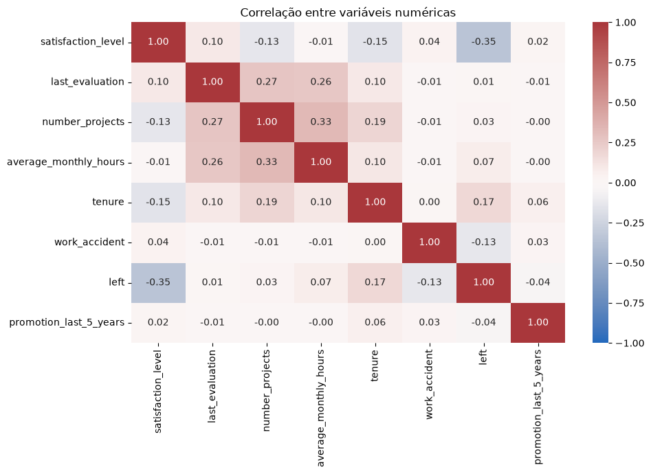
</p>

- `satisfaction_level` apresenta a maior correlação linear com `left` (**`r = -0,35`**), seguida por `tenure` (`r = 0,17`) e `work_accident` (`r = -0,13`).
- Observe como a correlação linear de Pearson entre `number_projects` e `left` é próxima de zero (**`r = 0,03`**) e com `average_monthly_hours` é baixa (**`r = 0,07`**), apesar de ambas determinarem fortemente as saídas. Isso ocorre porque **correlações lineares cancelam efeitos opostos nas duas caudas** (curva em U de `2` vs. `6–7` projetos e bimodalidade das horas), justificando tecnicamente o uso de **modelos não lineares baseados em árvores**.

---

### 4.3 Testes Formais de Hipóteses Estatísticas

Para validar com rigor inferencial (`α = 0,05`) as diferenças observadas na EDA, aplicamos testes paramétricos e não paramétricos em `df_clean` (`n = 11.991`):

- **Variáveis contínuas:** pareamos o **teste *t* de Welch** (`equal_var=False`, robusto a variâncias desiguais) com o **teste não paramétrico de Mann-Whitney *U***, ideal diante da forte bimodalidade de `average_monthly_hours` no grupo desligado (`IQR = 116,5 h` vs. `76,0 h`).
- **Variáveis categóricas:** aplicamos o **teste Qui-quadrado de independência (`χ²`)**.

#### Resultados — Variáveis Numéricas (`H₀`: distribuições/médias iguais entre ativos e desligados)

| Variável | Média (Ficou) | Média (Saiu) | Mediana (Ficou) | Mediana (Saiu) | Estatística *t* (Welch) | *p*-valor (Welch) | *p*-valor (Mann-Whitney) | Decisão (`α = 0,05`) |
| :--- | :---: | :---: | :---: | :---: | :---: | :---: | :---: | :---: |
| `satisfaction_level` | `0,6674` | `0,4403` | `0,69` | `0,41` | `-35,8893` | `1,19e-228` | `2,24e-266` | **Rejeita H₀** |
| `average_monthly_hours` | `198,9427` | `208,1622` | `198,00` | `226,00` | `+6,3688` | `2,27e-10` | `1,83e-07` | **Rejeita H₀** |

> **Nota estatística:** em `average_monthly_hours`, embora a diferença entre médias seja de `+9,2 h`, a **mediana entre desligados salta `+28,0 h`** (`226 h` vs. `198 h`), refletindo o peso do grupo sobrecarregado parcialmente compensado na média pelo grupo subalocado.

#### Resultados — Variáveis Categóricas (`H₀`: independência em relação a `left`)

| Variável | Qui-quadrado (`χ²`) | Graus de Liberdade | *p*-valor | Decisão (`α = 0,05`) |
| :--- | :---: | :---: | :---: | :---: |
| `promotion_last_5_years` | `22,9921` | `1` | `1,63e-06` | **Rejeita H₀** |
| `salary` | `175,2107` | `2` | `8,98e-39` | **Rejeita H₀** |
| `work_accident` | `187,7378` | `1` | `9,91e-43` | **Rejeita H₀** |

---

## 5. Etapa 3 — Construct (Construir)


Na etapa **Construct**, estruturamos o pipeline de engenharia de atributos, verificamos os pressupostos estatísticos e treinamos **10 modelos** distribuídos em quatro famílias algorítmicas e três cenários de negócio.

<br clear="left"/>

### 5.1 Preparação de Atributos e Multicolinearidade (VIF)

1. **Codificação de variáveis:**
   - `salary`: codificação ordinal preservando a hierarquia remuneratória (`low = 0`, `medium = 1`, `high = 2`).
   - `department`: *One-Hot Encoding* (`pd.get_dummies(..., drop_first=True)`), gerando 9 variáveis indicadoras.
2. **Diagnóstico de Multicolinearidade (*Variance Inflation Factor* — VIF):**
   - Todos os preditores numéricos/ordinais apresentaram **VIF entre `1,00` e `1,26`** (`number_projects = 1,26`, `average_monthly_hours = 1,18`, `last_evaluation = 1,16`, `tenure = 1,13`, `satisfaction_level = 1,10`, `salary = 1,01`), e as *dummies* de departamento ficaram entre `1,35` e `3,12`, bem abaixo do limiar crítico (`5,0`), descartando multicolinearidade severa.
3. **Divisão Treino / Teste Estratificada (`75% / 25%`):**
   - Sobre `df_model` (`11.167` registros após filtro de *outliers* em `tenure`), aplicou-se `train_test_split(..., test_size=0.25, stratify=y, random_state=0)`:
   - **Treino:** `8.375` colaboradores (usado na validação cruzada estratificada de 5 *folds*).
   - **Teste (*Holdout* intocado):** `2.792` colaboradores (`2.321` ativos e `471` desligamentos).

---

### 5.2 Desenho Experimental: Cenários A, B e C

Para responder tanto ao desempenho máximo quanto à aplicabilidade real no RH, avaliamos três cenários:

| Cenário | Conjunto de Preditores | Objetivo Analítico e de Negócio |
| :--- | :--- | :--- |
| **Modelo A** *(Completo)* | Todas as variáveis (incluindo `satisfaction_level` e `average_monthly_hours`) | Avalia o poder preditivo máximo quando o RH dispõe dos resultados recentes da pesquisa de satisfação. |
| **Modelo B** *(Sem Satisfação)* | Remove `satisfaction_level` | Elimina risco de *data leakage* pós-decisão e permite monitorar risco de saída continuamente **sem depender de pesquisas de clima**. |
| **Modelo C** *(Feature `overworked`)* | Remove `satisfaction_level` e substitui `average_monthly_hours` por `overworked` (`1` se `> 175 h/mês`, `0` caso contrário) | Testa se uma flag binária simples de horas extras substitui a variável contínua sem perda relevante de sinal. |

Em cada cenário de árvores, a busca de hiperparâmetros foi realizada com `GridSearchCV(cv=5, refit='roc_auc')` exclusivamente no conjunto de treino:
- **Regressão Logística** *(baseline linear interpretável no Cenário A)*.
- **Árvore de Decisão (`DecisionTreeClassifier`)**: grade em `max_depth`, `min_samples_leaf`, `min_samples_split`.
- **Random Forest (`RandomForestClassifier`)**: *bagging* de árvores com grade em `n_estimators` (`100, 300`), `max_depth`, `min_samples_leaf`, `min_samples_split`.
- **XGBoost (`XGBClassifier`)**: *gradient boosting* sequencial com grade em `max_depth` (`4, 6, 8`), `min_child_weight` (`1, 3, 5`), `learning_rate` (`0.1, 0.2`) e `n_estimators` (`100, 200`).

---

### 5.3 Desempenho dos 10 Modelos

Resultados consolidados no conjunto de teste independente (`2.792` registros), ordenados por **ROC-AUC**:

| Ranking | Cenário / Modelo | Hiperparâmetros (`GridSearchCV`) | Accuracy | Precision | Recall | F1-score | ROC-AUC |
| :---: | :--- | :--- | :---: | :---: | :---: | :---: | :---: |
| **1º** | **A — XGBoost** | `lr=0.1, max_depth=4, min_child=1, n_est=100` | **0,9850** | 0,9694 | **0,9406** | **0,9547** | **0,9895** |
| **2º** | **A — Random Forest** | `max_depth=None, leaf=3, split=2, n_est=300` | **0,9850** | **0,9864** | 0,9236 | 0,9539 | 0,9847 |
| **3º** | **B — XGBoost** | `lr=0.1, max_depth=4, min_child=1, n_est=100` | 0,9774 | 0,9397 | 0,9257 | 0,9326 | 0,9835 |
| **4º** | **A — Árvore de Decisão** | `max_depth=4, min_samples_leaf=5, split=2` | 0,9814 | 0,9584 | 0,9299 | 0,9440 | 0,9779 |
| **5º** | **C — XGBoost** | `lr=0.1, max_depth=4, min_child=1, n_est=100` | 0,9706 | 0,9130 | 0,9130 | 0,9130 | 0,9767 |
| **6º** | **B — Árvore de Decisão** | `max_depth=6, min_samples_leaf=1, split=4` | 0,9792 | 0,9499 | 0,9257 | 0,9376 | 0,9766 |
| **7º** | **B — Random Forest** | `max_depth=5, leaf=1, split=2, n_est=300` | 0,9402 | 0,9393 | 0,6900 | 0,7956 | 0,9765 |
| **8º** | **C — Random Forest** | `max_depth=5, leaf=2, split=2, n_est=100` | 0,9330 | 0,9128 | 0,6667 | 0,7706 | 0,9711 |
| **9º** | **C — Árvore de Decisão** | `max_depth=4, min_samples_leaf=1, split=2` | 0,9588 | 0,8504 | 0,9172 | 0,8825 | 0,9644 |
| **10º** | **A — Regressão Logística** | *Baseline linear padrão* | 0,8256 | 0,4667 | 0,2378 | 0,3150 | 0,8923 |

#### Curvas ROC (Cenário A) e Comparação Visual entre Cenários A, B e C

<p align="center">
  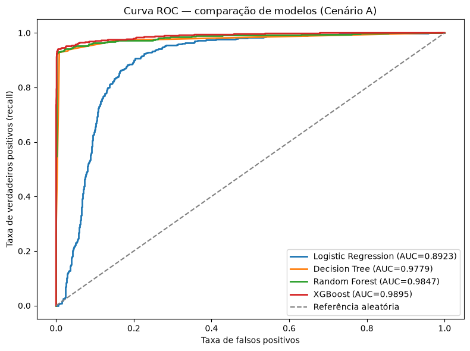
</p>

<p align="center">
  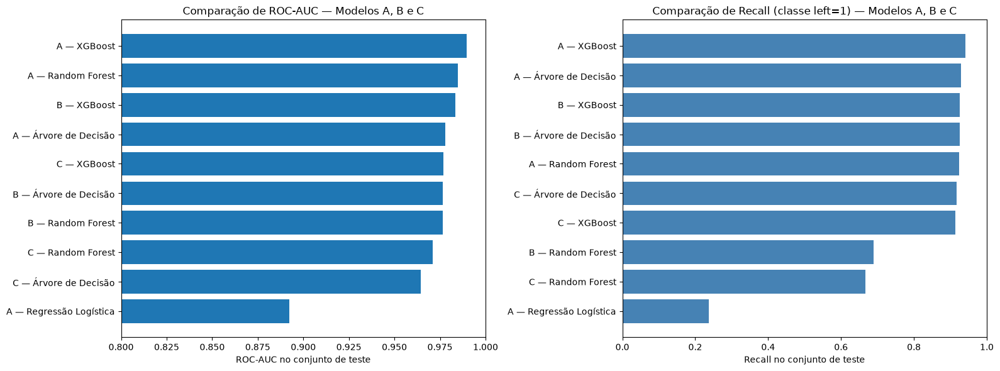
</p>

#### Matrizes de Confusão dos Modelos Campeões (`XGBoost A` vs. `XGBoost B`)

<table>
  <tr>
    <td width="50%" align="center">
      <b>Cenário A — XGBoost (Com Satisfação)</b><br/>
      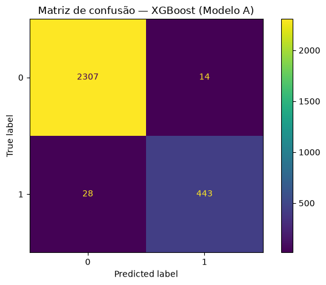<br/>
      <sub><b>443</b> saídas detectadas de 471 (<b>94,1% Recall</b>) e apenas <b>14</b> falsos positivos em 2.321 ativos (<b>96,9% Precision</b>).</sub>
    </td>
    <td width="50%" align="center">
      <b>Cenário B — XGBoost (Sem Satisfação)</b><br/>
      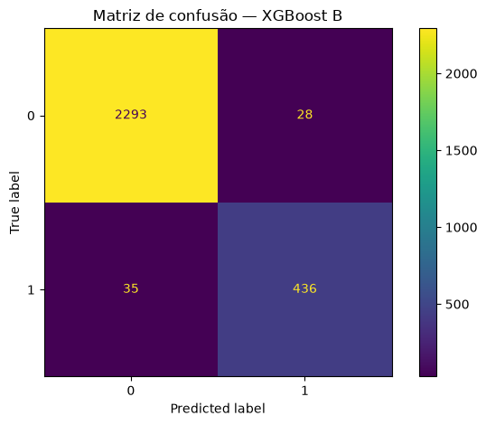<br/>
      <sub>Mesmo sem pesquisa de clima, detecta <b>436</b> das 471 saídas (<b>92,6% Recall</b>) com apenas <b>28</b> falsos positivos (<b>94,0% Precision</b>).</sub>
    </td>
  </tr>
</table>

#### Principais Conclusões da Modelagem
1. **Por que a Regressão Logística falhou (`23,78%` de Recall)?** Sem termos polinomiais ou interações explícitas, uma fronteira linear no *log-odds* não consegue separar simultaneamente saídas nos dois extremos de projetos (`2` e `6–7`) e horas (`< 160 h` e `> 240 h`).
2. **Por que o XGBoost superou a Random Forest no Cenário B (`92,57%` vs. `69,00%` de Recall)?** Sem `satisfaction_level`, a Random Forest selecionou `max_depth = 5` no `GridSearchCV`, cuja média por *bagging* comprimiu as probabilidades previstas abaixo do corte padrão `0,50`. Já o **XGBoost**, por corrigir sequencialmente os erros residuais a cada árvore (*boosting*), preservou probabilidades bem calibradas e altíssimo poder de detecção.
3. **Efeito da binarização em `overworked` (Cenário C):** resumir `average_monthly_hours` em `> 175 h` reduziu o `ROC-AUC` e o `F1-score` em todas as arquiteturas, pois mistura subalocação (`130 h`) com jornada regular (`170 h`) e iguala horas extras leves (`180 h`) a jornadas críticas (`280 h`).

---

## 6. Etapa 4 — Execute (Executar)


Na etapa final **Execute**, observamos a importância de variáveis, ajuste o limiar operacional de decisão e traduzimos as evidências em um plano estratégico para a liderança da Salifort Motors.

<br clear="left"/>

### 6.1 Importância das Variáveis (*Feature Importance*)

#### Cenário A: `XGBoost` (*Gain*) vs. `Random Forest` (*Impureza de Gini*)

<table>
  <tr>
    <td width="50%" align="center">
      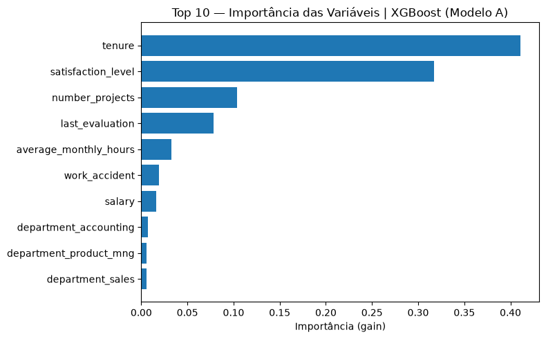
    </td>
    <td width="50%" align="center">
      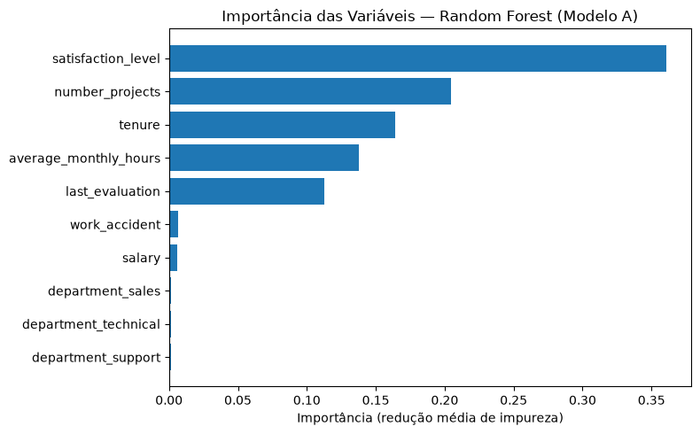
    </td>
  </tr>
</table>

- Na **Random Forest A** (redução média de impureza de Gini), `satisfaction_level` (`0,36`), `number_projects` (`0,20`), `tenure` (`0,16`), `average_monthly_hours` (`0,14`) e `last_evaluation` (`0,11`) concentram mais de `97%` do poder explicativo.
- No **XGBoost A** (ganho médio por divisão / *gain*), os cortes em `tenure` (`0,41`) e `satisfaction_level` (`0,32`), combinados a `number_projects` (`0,10`) e `last_evaluation` (`0,08`), produzem os maiores ganhos informativos na redução da perda logística.

#### Cenários B e C: O que impulsiona o modelo quando não há pesquisa de satisfação?

<p align="center">
  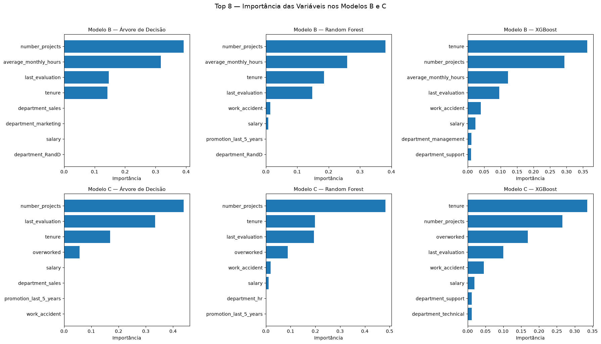
</p>

Na ausência de `satisfaction_level` (**Modelo B**), a carga operacional e a trajetória na empresa assumem total protagonismo nos três algoritmos:
- **Árvore B e Random Forest B:** `number_projects` (`0,38–0,39`) e `average_monthly_hours` (`0,26–0,32`), seguidos por `tenure` e `last_evaluation`.
- **XGBoost B:** `tenure` (`0,36`), `number_projects` (`0,29`), `average_monthly_hours` (`0,12`) e `last_evaluation` (`0,10`).

---

### 6.2 Calibração de Limiar de Decisão (*Threshold Tuning*)

Em aplicações reais de People Analytics, o limiar padrão de probabilidade (`0,50`) pode ser ajustado conforme o objetivo do RH — priorizando **maior cobertura preventiva (*Recall*)** ou **maior foco cirúrgico (*Precision*)**:

<table>
  <tr>
    <td width="54%" align="center">
      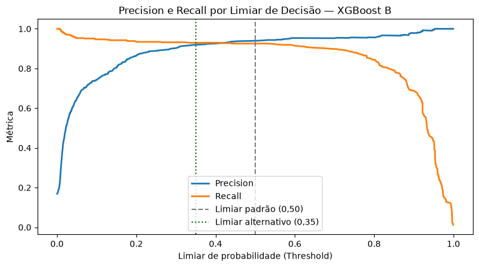
    </td>
    <td width="46%" valign="top">

| Limiar (*Threshold*) | Accuracy | Precision | Recall | F1-score |
| :---: | :---: | :---: | :---: | :---: |
| `0,25` | 0,9692 | 0,8889 | **0,9342** | 0,9110 |
| `0,30` | 0,9717 | 0,9033 | 0,9321 | 0,9175 |
| **`0,35`** *(Preventivo)* | 0,9746 | 0,9202 | **0,9299** | 0,9250 |
| `0,40` | 0,9756 | 0,9260 | 0,9299 | 0,9280 |
| **`0,50`** *(Padrão)* | 0,9774 | 0,9397 | 0,9257 | 0,9326 |
| `0,60` *(Conservador)* | **0,9778** | **0,9534** | 0,9130 | **0,9328** |

</td>
  </tr>
</table>

Reduzir o limiar do **XGBoost B** para `0,35` amplia o **Recall** para `92,99%` mantendo `92,02%` de **Precision**, enquanto elevá-lo para `0,60` atinge `95,34%` de **Precision** quando os recursos para programas de retenção forem mais restritos.

---

### 6.3 Recomendações Estratégicas para Liderança e RH

Com base nas evidências da EDA, dos testes de hipóteses e dos modelos preditivos, recomendamos quatro frentes prioritárias à liderança da Salifort Motors:

1. **Reequilíbrio imediato da carteira de projetos (meta: `3` a `5` projetos por colaborador):**
   - Estabelecer teto operacional para eliminar alocações em **`7` projetos (`100%` de saída)** e revisar casos com **`6` projetos (`44,9%` de saída)**.
   - Investigar equipes com colaboradores estagnados em **`2` projetos (`54,2%` de saída)** para corrigir falhas de integração (*onboarding*), subaproveitamento ou desalinhamento de função.
2. **Monitoramento saudável de jornada mensal:**
   - Acompanhar preventivamente cargas sistemáticas acima de **`220 h/mês`** (mediana dos desligados: `226 h/mês`), revendo prazos, dimensionamento de equipes e compensação de horas antes da instalação de *burnout*.
3. **Plano estruturado de carreira, reconhecimento e progressão entre o 3º e o 5º ano (`tenure`):**
   - Como a taxa de saída salta de `1,1%` (2º ano) para `24,7%` (4º ano) e **`45,4%` (5º ano)**, implantar janelas formais de revisão salarial e trilha de promoção (hoje restrita a `1,7%` do quadro em 5 anos), especialmente para profissionais de alta avaliação na faixa salarial `low` (`20,5%` de saída).
4. **Adoção dual dos modelos para gestão preventiva agregada:**
   - Utilizar o **XGBoost B** continuamente sobre indicadores operacionais de RH para mapear **áreas e equipes sob risco**, complementando-o com o **XGBoost A** após rodadas periódicas de pesquisa anônima/estruturada de clima.

---

### 6.4 Limitações, Ética em People Analytics e Próximos Passos

- **Uso ético e supervisão humana obrigatória:** escores preditivos de rotatividade **jamais** devem ser usados para punir, preterir em promoções ou demitir preventivamente um colaborador individual. As previsões devem orientar **diagnósticos agregados de gestão, melhoria de processos e diálogo de apoio**.
- **Limitações atuais dos dados:**
  1. Falta de carimbo temporal (*timestamp*) na coleta de `satisfaction_level`.
  2. Agrupamento de pedidos voluntários de demissão e demissões involuntárias no mesmo rótulo `left = 1`.
  3. Necessidade de auditar o registro administrativo de `work_accident`.
- **Próximos passos técnicos:**
  - Implementar validação temporal (*out-of-time split*) garantindo antecedência estrita das variáveis explicativas.
  - Separar modelos para *turnover voluntário* vs. *involuntário*.
  - Avaliar métricas de equidade (*fairness* — igualdade de taxa de falsos positivos/negativos) entre departamentos e faixas salariais, além de reavaliar os modelos de árvores mantendo os colaboradores veteranos (`tenure > 5,5` anos).

---

## 7. Estrutura do Repositório e Como Executar

```text
Salifort-Motors/
├── Data/
│   └── HR_capstone_dataset.csv                # Base bruta da pesquisa de RH (14.999 registros)
├── Docs/
│   ├── PACE_strategy_document.pdf             # Documento completo de estratégia PACE
│   └── Resumo_executivo_retencao_Salifort.pdf # Resumo executivo de 1 página para liderança e RH
├── Image/
│   ├── Pace.png                               # Diagrama geral da metodologia PACE
│   ├── Plan.png | Analyze.png | Construct.png | Execute.png
│   └── charts/                                # Gráficos de EDA e avaliação dos modelos exportados do notebook
├── Notebook/
│   └── Salifort_Motors_project_lab.ipynb      # Notebook completo executado (EDA, Testes Estatísticos e ML)
└── README.md
```

### Como Reproduzir Localmente

1. **Instale as dependências** (Python `3.10+`):

```bash
pip install pandas numpy scipy matplotlib seaborn scikit-learn xgboost jupyter
```

2. **Abra e execute o notebook** a partir da raiz do repositório:

```bash
jupyter lab Notebook/Salifort_Motors_project_lab.ipynb
```

Execute todas as células em sequência (*Kernel > Restart Kernel and Run All Cells*). O script localiza automaticamente `../Data/HR_capstone_dataset.csv` e reproduz integralmente as tabelas, testes estatísticos e gráficos apresentados neste documento.

---

### Documentos do Projeto

- **Notebook Técnico Executado:** [Notebook/Salifort_Motors_project_lab.ipynb](Notebook/Salifort_Motors_project_lab.ipynb)
- **Documento de Estratégia PACE (PDF):** [Docs/PACE_strategy_document.pdf](Docs/PACE_strategy_document.pdf)
- **Resumo Executivo para Liderança (PDF):** [Docs/Resumo_executivo_retencao_Salifort.pdf](Docs/Resumo_executivo_retencao_Salifort.pdf)
